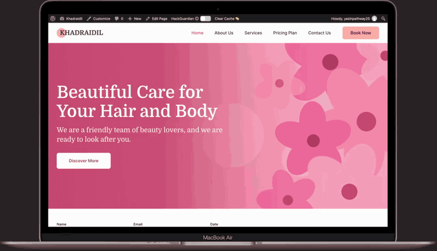

# Blush Salon WordPress Theme 🌸

[](https://wordpress.org)
[](https://php.net)
[](https://elementor.com)
[](LICENSE)
[](style.css)

> **Blush Salon** is an elegant, modern, and high-performance WordPress theme designed specifically for beauty salons, luxury spas, nail bars, hair stylists, aesthetic clinics, and wellness studios.

Featuring a soft pink aesthetic, native AJAX appointment booking, one-click demo content setup, and **full Elementor page builder compatibility**.

<p align="center">
  
  <br>
  <sub><a href="docs/theme-preview.mp4">▶ Watch the full-quality video (MP4)</a></sub>
</p>

---

## 🌟 Live Demo & Quick Download

- **Live Preview:** [View Live Demo Site](https://khadraidil-151609a.ingress-comporellon.ewp.live/)
- **Download Latest Release (.zip):** [Download blush-salon.zip](https://github.com/yaasiinaxmed/blush-salon-theme-wordpress/releases/latest)

> ⭐ **Like this theme?** [Give it a star](https://github.com/yaasiinaxmed/blush-salon-theme-wordpress) so more salon owners and developers can find it.

---

## 🚀 Key Features

### 🎨 1. Full Elementor Page Builder Compatibility
- **Edit Any Page with Elementor:** Open the Home page, About, Services, Pricing, or Contact templates directly inside Elementor. The pre-coded sections gracefully yield to Elementor's visual canvas.
- **Elementor Full Width Template:** Create custom edge-to-edge landing pages with header and footer preserved.
- **Elementor Pro Ready:** Built-in support for Elementor Pro Theme Builder locations (`header`, `footer`, `single`, `archive`).

### 📅 2. Built-in Booking & Lead Management (No Plugins Needed)
- **Interactive Booking Form:** Visitors can choose services, preferred dates, times, and stylists.
- **Admin Storage:** Bookings, contact messages, and newsletter subscribers are securely saved directly in your WordPress dashboard under private custom post types (`blush_appointment`, `blush_message`, `blush_subscriber`).
- **Instant Email Alerts:** Notifies salon owners immediately upon booking.

### 💼 3. Custom Post Types & Meta Boxes
- **Services (`blush_service`):** Showcase treatments with custom price fields, durations, and excerpts.
- **Testimonials (`blush_testimonial`):** Client feedback, ratings, and avatars.
- **Team (`blush_team`):** Stylist profiles, bios, job roles, and social handles.
- **Pricing Plans (`blush_plan`):** Tiered packages, feature lists, and booking CTAs.
- **FAQs (`blush_faq`):** Accordion questions and answers.

### 🪄 4. One-Click Demo Setup
- Built-in demo importer under **Appearance > Blush Salon Setup**.
- Instantly sets up all sample pages, services, team members, pricing plans, and reviews in seconds.

### 🔒 5. Privacy & GDPR Compliant
- **Locally Hosted Web Fonts:** Google Fonts (*Domine* and *Inter*) are served directly from the theme's local assets. Zero data is leaked to external Google servers.
- **Native Inline SVGs:** Clean, fast vector icons without external icon font bloat.

---

## 🧩 Shortcode Reference (Elementor & Block Editor)

Use these shortcodes anywhere in your WordPress site or drag a **Shortcode** widget inside Elementor:

| Shortcode | Description | Example / Parameters |
| :--- | :--- | :--- |
| `[blush_booking_form]` | Displays the full appointment booking form | `[blush_booking_form]` |
| `[blush_booking_bar]` | Displays the quick booking bar & phone contact box | `[blush_booking_bar]` |
| `[blush_services]` | Displays the services grid | `[blush_services limit="6" show_button="true"]` |
| `[blush_pricing]` | Displays tiered pricing packages | `[blush_pricing]` |
| `[blush_testimonials]`| Displays customer testimonials & reviews | `[blush_testimonials]` |
| `[blush_team]` | Displays stylists and team member cards | `[blush_team]` |
| `[blush_faqs]` | Displays interactive FAQ accordion | `[blush_faqs]` |
| `[blush_contact_form]`| Displays salon contact info, hours, & message form | `[blush_contact_form]` |
| `[blush_about]` | Displays the About Us story section | `[blush_about]` |
| `[blush_why]` | Displays the "Why Choose Us" features | `[blush_why]` |
| `[blush_cta]` | Displays the booking call-to-action banner | `[blush_cta]` |
| `[blush_logos]` | Displays client / brand partner logos | `[blush_logos]` |
| `[blush_video]` | Displays the promotional video banner | `[blush_video]` |
| `[blush_map]` | Displays Google Maps embed | `[blush_map]` |

---

## 📥 Installation

### Method A: Install via WordPress Admin (Recommended)
1. Download the latest `blush-salon.zip` from [Releases](https://github.com/yaasiinaxmed/blush-salon-theme-wordpress/releases).
2. Go to your WordPress Dashboard → **Appearance → Themes**.
3. Click **Add New Theme** → **Upload Theme**.
4. Choose `blush-salon.zip` and click **Install Now**.
5. Click **Activate**.
6. Navigate to **Appearance → Blush Salon Setup** to import sample demo content.

### Method B: Install via Git
```bash
cd wp-content/themes
git clone https://github.com/yaasiinaxmed/blush-salon-theme-wordpress.git blush-salon
```
Then activate **Blush Salon** from your WordPress Dashboard under **Appearance → Themes**.

---

## 🛠️ Customization & Settings

- **Live Customizer:** Go to **Appearance → Customize** to adjust colors (primary, accent, blush background), header logo, business phone number, address, opening hours, and social media links.
- **Navigation Menus:** Set your menus under **Appearance → Menus** (Primary Menu, Footer Company, Footer Support, Legal Bar).

---

## 📂 Project Architecture

```
blush-salon/
├── assets/
│   ├── css/main.css              # Main theme stylesheet & Elementor rules
│   ├── fonts/                    # Locally bundled GDPR-compliant fonts
│   ├── images/                   # Placeholder illustrations & icons
│   └── js/main.js                # Navigation, accordions, and interactions
├── inc/
│   ├── config.php                # Theme defaults & palette config
│   ├── customizer.php            # WordPress Customizer controls
│   ├── demo-import.php           # 1-Click demo content generator
│   ├── elementor.php             # Elementor compatibility & shortcode handlers
│   ├── forms.php                 # AJAX booking, contact, & newsletter handlers
│   ├── icons.php                 # Inline SVG icons helper
│   ├── meta-boxes.php            # Custom fields for prices, hours, roles
│   ├── post-types.php            # CPT definitions (Services, Team, FAQs, Bookings)
│   ├── setup.php                 # Menus, image sizes, and asset enqueuing
│   └── template-tags.php         # Presentation functions & helpers
├── page-templates/
│   ├── template-about.php        # About page template
│   ├── template-contact.php      # Contact page template
│   ├── template-elementor-full-width.php # Full Width Elementor template
│   ├── template-pricing.php      # Pricing page template
│   └── template-services.php     # Services directory template
├── template-parts/               # Modular section components
├── front-page.php                # Homepage layout controller
├── functions.php                 # Core bootstrap loader
├── style.css                     # Theme headers & meta
└── README.md                     # Documentation
```

---

## 🤝 Contributing

Contributions of every size are welcome: code, translations, design, docs, bug reports and ideas.

**Where to start**

- 🌱 Browse [good first issues](https://github.com/yaasiinaxmed/blush-salon-theme-wordpress/labels/good%20first%20issue), small tasks that are easy to pick up.
- 🙋 See [help wanted](https://github.com/yaasiinaxmed/blush-salon-theme-wordpress/labels/help%20wanted) for bigger features.
- 🐛 Found a bug or have an idea? [Open an issue](https://github.com/yaasiinaxmed/blush-salon-theme-wordpress/issues/new/choose); templates guide you.
- 🌍 Translate the theme: copy `languages/blush-salon.pot` and send a PR with your `.po` file.

Please read [CONTRIBUTING.md](CONTRIBUTING.md) for code standards and the pull request workflow.

### Roadmap

- [x] Elementor support with editable demo layouts
- [x] Automatic GitHub releases
- [ ] More translations
- [ ] Dark mode option
- [ ] WooCommerce support for salon products
- [ ] Native Elementor widgets for services, pricing and team
- [ ] More page templates (gallery, blog landing)

Have an idea for the roadmap? Open a feature request.

All participants are expected to adhere to our [Code of Conduct](CODE_OF_CONDUCT.md).

---

## 📄 License

Blush Salon is open-source software licensed under the **[GNU General Public License v2.0 or later](LICENSE)**.

- **Fonts:** Domine & Inter (SIL Open Font License 1.1)
- **Placeholder Graphics:** GPL v2.0 or later

## Releasing

Releases are automated with GitHub Actions (`.github/workflows/release.yml`).

1. Bump the version in `style.css` (`Version:`), `functions.php` (`BLUSH_VERSION`) and `readme.txt` (`Stable tag` + a new `= X.Y.Z =` changelog entry).
2. Commit and push to `main`.
3. The workflow lints the PHP, builds `blush-salon.zip`, creates the tag `vX.Y.Z` and publishes a GitHub Release using that changelog entry as notes.

If the tag for the current version already exists, the push is skipped (no duplicate release).

## Using page builders

The theme works with Elementor, Beaver Builder, Divi, WPBakery, SiteOrigin, Brizy and Bricks.

### Editing the demo layouts in Elementor

Open a page that uses a designed template (Home, About, Services, Pricing, Contact) in Elementor for the first time. The theme loads that page's layout as real Elementor containers and widgets, so you can click and edit it:

- Hero, About, CTA banner, Why Choose Us, Video banner, Vision/Mission/Motto: headings, text, buttons, icons and **images (background and collage images)** are all editable in Elementor.
- Dynamic sections are Shortcode widgets, because their content lives in the WordPress admin: Services, Pricing Plans, Team, Testimonials, FAQs (edit under their menus; change a person's photo with the Featured Image), the booking and contact forms, partner logos and the map.
- Nothing is saved until you click **Publish / Update**. If you leave without publishing, the page is unchanged.
- After you publish, the page shows your Elementor content. To get the original layout back, delete all content in Elementor, publish, and reopen the page.

### Other options

| I want to... | Do this |
| :--- | :--- |
| Design a page from scratch | Set the page Template to **Elementor Full Width** (or use the default page template), then open it in your builder. |
| Add salon modules inside a builder | Use a Shortcode widget: `[blush_booking_form]`, `[blush_services]`, `[blush_pricing]`, `[blush_team]`, `[blush_testimonials]`, `[blush_faqs]`, `[blush_contact_form]` |

The home page honours the Template chosen in Page Attributes, so **Elementor Full Width** works on Home too.

Developers: use the `blush_has_builder_content` and `blush_is_builder_editing` filters to add support for another builder, and `blush_elementor_demo_elements` to change the layouts offered to Elementor.
